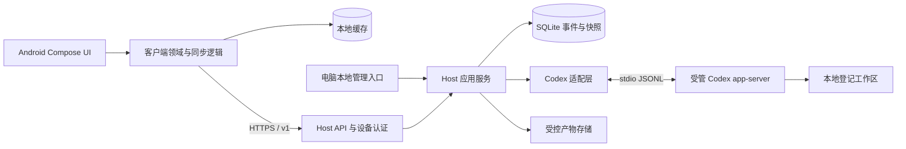

# 首版架构设计

日期：2026-10-23。状态：产品架构设计基线；M0 探针与独立存储切片已有实现，业务模块与性能尚未验证，实际进度见 [progress.md](../progress.md)。产品范围见 [PRD](PRD.md)，字段和状态以 [PROTOCOL.md](PROTOCOL.md) 为准。

## 1. 系统边界

Android 负责视图、缓存、同步、阅读位置和受限操作。Host 负责认证、会话归属、状态、顺序、审批和进程生命周期。Codex 负责 Agent 执行及其权限机制。Runvori 不复刻模型循环，不实现终端模拟器，也不直接向手机暴露 app-server。

## 2. 运行与模块约定

### Host

首版使用单 Host 进程、单 API worker、一个受管 app-server，以及一个 SQLite 数据库。启动时获取本机单实例锁；没有可靠获得锁就拒绝启动。不得用多个 HTTP worker 进程绕过内存进程所有权和活动槽约束。

当前有一个内部有界命令邮箱，供未来 API 线程提交固定的回合启动、中断、审批决定、thread 读取和操作查询请求；持有 SQLite 连接的连接所有者执行存储操作并唤醒已有 stdio 队列。审批决定只有返回 `accepted` 才进入一次派发队列；超时不取消可能已提交的命令，信号队列满时明确报告，保留持久操作供原请求号查询和显式重试。该切片尚不监听 HTTP，也未接入设备认证。

同一邮箱还提供单会话存储快照和增量/历史事件页读取，仍由连接所有者执行事件库的独立读事务。客户端可从快照序号开始补增量；正式 Host API 仍须加入认证、host 身份、响应投影及长轮询。

内部 `snapshot_tail` 进一步在单次读事务中组合存储快照与最近事件，按完整响应字节预算裁剪尾页并给出历史排他游标；邮箱可请求该读取模型。它只构成正式快照响应的存储部分，Host 身份、服务时间、鉴权和 HTTP 适配仍待完成。

事件库 v11 已在权威 Host 数据库中保存稳定随机 `host_id`，连接所有者经邮箱读取；独立配对库的秘密与令牌按此身份约束。内部 `HostDeviceAccess` 在持锁恢复成功后组合两库及读取邮箱，关闭后旧对象拒绝操作；`HostRuntime` 已按启动顺序接入该组合，正式快照与手机 API 尚未接入。新数据库生成新身份，已升级库身份缺失时拒绝打开。旧备份回滚的身份轮换及设备撤销仍需产品恢复流程。

内部增量事件等待在请求线程使用条件变量；邮箱受理的持久写入和归属连接事件交接完成后发出变更提示，等待线程据此重查持久页。代次核对避免查询与进入等待之间的丢唤醒；未接入通知的写路径由最多 250 毫秒的定时复查覆盖。数据库所有者不因等待被阻塞，空超时不写事件或推进游标。可信调用方可携带线程取消信号；取消会唤醒等待线程，排队中的读取由所有者跳过，已读出的页在调用方返回前再次检查取消状态。未来设备撤销或 Host 停止须设置对应信号，并在 HTTPS 响应发出前重新核验授权；目前配对记录与产品 Host 尚未连接，正式 HTTPS 适配仍待完成。

完整模块规划如下；当前有 `codex` 探针、CLI 及独立 SQLite 审批、事件和配对验证切片，其余业务模块待 M0 退出后按 M1 建立。当前单库切片已使审批请求、决定、派发领取、请求结束、操作、事件和快照分别在对应事务中提交；持锁启动恢复切片也可在一个事务中恢复审批与旧回合并推进 epoch。共享库在统一恢复前拒绝领域写入，旧审批探针不能直接改写共享库。上游审批请求按 thread/turn/epoch/类型化请求号定位活动回合，完整参数摘要约束重复请求；请求结束按 thread/epoch/类型化请求号匹配审批，回合终态按 thread/turn/epoch 匹配，在同一事务收尾未完成审批并释放活动槽，均有合成联动测试。真实 Codex 的五切点崩溃/重启、版本门与审批决定入口已有证据；HTTP API、手机审批详情和完整配对生命周期尚未纳入产品路径。旧双库探针数据不自动迁移。

当前有一个有界的上游单消息交接入口，用于顺序调用这些适配器；它在读取或持久化失败时关闭上游连接。另有基于当前 Host 归属连接的单步事件泵，在故障时先隔离并执行统一恢复，恢复失败保持写门控关闭。`HostRuntime` 已把长期事件循环、审批答复队列、thread 启动、回合启动、中断和 Host 启动/恢复编排组合到同一所有者线程。

审批答复已有一次派发切片：从单库读取已记录的身份和决定，先领取持久发送权再写 stdio；异常关闭上游并记未知。产品命令邮箱已把决定持久化与队列派发串联到归属事件循环。DEV-006 接通审批详情：请求参数与文件 item 落库为有界详情，详情不足时 `allow_once` 被拒绝；HTTP 详情读取与决定入口已可用。

新回合也已有一次派发切片：用原请求重放输入摘要校验，领取后发送 `turn/start`，识别响应再绑定已预留 run；异常关闭上游并保持操作未知。事件库 v9 保存不可改写的 session/thread 归属、thread 创建意图及本地工作区登记。创建切片在持久领取后发送固定参数的 `thread/start`，参数从会话关联的工作区根目录与策略读取；有效响应与绑定同事务提交，结果不明时不自动重发。派发只读取已确认绑定；`HostRuntime` 已组合本地 thread 创建队列，本地管理入口、可信补记与手机审批详情仍待实现。

当前还可在统一恢复后用持久绑定核对 `thread/resume` 响应；新回合派发在当前连接先完成该核对。由同一连接刚创建、尚无 rollout 的 thread 可跳过该核对并直接开始首回合；该标记只在内存中，重启后仍必须重新核对。失败时关闭上游连接，不改绑或领取发送权。受管进程与连接的完整所有权已由 `HostRuntime` 组合。

当前 Host 所持有的 Windows 上游连接已有启动归属与退出恢复切片：在持锁已恢复的 epoch 下先预留唯一连接位，再启动并初始化；启动器身份（PID＋创建时间）在目标进程放行前写入事件库 v12，下一个启动周期据此核实旧进程已不在运行，否则拒绝恢复并保持写门禁关闭。退出时先关闭共享写门控，再关闭 stdio 与 kill-on-close Job，核对父进程退出和 Job 句柄释放后，根据活动槽中的 run ID/版本执行统一恢复。Host 关闭时先隔离仍归属的连接。该记录只覆盖启动器进程，不证明后代树已停止。

事件库 v13 现已把 epoch 身份状态显式化：`unlaunched` 表示已恢复但尚未启动上游，`recorded` 表示有 PID＋创建时间可核实，`legacy_unknown` 表示 v13 之前的 epoch 无法核实。恢复门禁不再接受“缺少记录”，任一不一致都失败关闭；旧库只能归档重建。`HostRuntime`（`python -m runvori.host`）把单实例锁、状态对账、统一恢复、写门禁、命令邮箱、`HostDeviceAccess` 与唯一上游启动按固定顺序组合，并运行单所有者事件循环；锁定版本探测先于任何持久状态。正常停止以 `host_shutdown` 恢复；上游故障完成 `upstream_exit` 恢复后 Host 进程退出，等待外部监督重启，不在进程内重拉上游或重跑旧回合。真实 Codex 已用于五切点崩溃证据。

DEV-006 把两个入口接到该组合上，均为可选：`--listen host:port` 加证书/私钥启动标准库 HTTPS 服务（`api/`），`--admin-pipe` 启动 Windows 命名管道管理入口。两者都不持有 SQLite 连接，只经命令邮箱读写；`HostRuntime` 在上游启动后按“管道 → HTTPS”顺序启动，任一失败整体回滚，并在事件循环结束或停止时先关入口再关邮箱。事件库 v14 为审批保存有界详情（`approval_details.py` + `approval_items` 表），详情不足时禁止允许。真实 Codex HTTPS 一次闭环与合成闭环见 [证据](evidence/DEV-006-https-host.md) 与 [真实验收](evidence/DEV-006-https-host-real.md)；当时尚未接入的会话列表与 Android 联调已由 DEV-007 补齐（见下），命令明细与产物明细由 DEV-008 补齐。

DEV-007 补齐了手机侧需要但 Host 还缺的三块：`GET /v1/sessions` 会话列表、`GET /v1/runs/{run_id}/approvals` 按回合列审批、以及把上游 item 生命周期投影成可读时间线（事件库 v15）。投影层（`codex/item_events.py`）不信任调用方给的标识：每条时间线写入都用持久化的 `(thread_id, turn_id)` 绑定定位活动回合，找不到就返回 `upstream_turn_not_found` 而不写。时间线事件只推进 `seq`，不改 `session_version`，否则持续输出会让每个待审批的期望版本立刻过期。单回合文本有 2 MiB 预算（`run_timeline_budget` 表），超出后写入不带正文的元数据与一次 `timeline.truncated`，把缺口变成可见事实而不是空输出。TLS 握手改在 accept 线程完成（`_ThreadedHttps.get_request`），此前在工作线程 wrap 会让并发握手在同一对 socket 上交错。Android 联调见 [合成设备验收](evidence/DEV-007-device-acceptance.md) 与 [真实设备验收](evidence/DEV-007-device-acceptance-real.md)（真实 Codex 核心闭环 1 次模型回合）。

DEV-008 把命令从“时间线里的一行”提升为可查询证据：事件库 v16 新增 `run_commands`（命令、cwd、上游起止时间、退出码、输出完整度、事件 seq）与 `run_verifications`（回合创建时快照的必需命令），工作区配置从受信本地入口写入 `verification_json`。`application/run_results.py` 在读取时把持久证据重放给 `codex/verification.py`，复用其保守优先级，不把空配置当通过，也不把 null 退出码当 0。`GET /v1/runs/{run_id}`、`/results` 与 `/commands` 已接入；Android 新增“回合结果”屏幕，把回合状态和验证结论分开显示。

DEV-008 第二切片把结果页接到受控产物：事件库 v17 新增 `run_artifacts` 与 `artifact_chunks`，产物 ID 由 `(run_id, kind, source, item_id/approval_id, path)` 确定性生成，客户端只能凭 ID 读取。命令输出只复制时间线实际持久化的字节，预算丢弃量保留为 `dropped_bytes`；文件差异同时保留“审批提案”和“上游报告完成”两个来源，首次读取时另做一次 Git 工作区快照并固定标为 `attribution=unknown`。`GET /v1/runs/{run_id}/artifacts` 与分块内容端点已接入，Android 增加产物详情子页。`verification.updated`、`artifact.created` 事件仍未实现；真实 Codex 文件审批与 Windows 命令包装匹配仍待验收，见 [第一切片证据](evidence/DEV-008-results.md) 与 [第二切片证据](evidence/DEV-008-artifacts.md)。

DEV-008 第三切片处理真实上游与重启后的证据归属：`approval_details.normalize_item_paths` 只把该 run 登记工作区内的绝对 path/move_path 转为相对 POSIX 路径，工作区外/UNC/转义保持不安全；没有 diff 的审批不能允许。`item_events.py` 把文件 `item/updated` 与 started/completed 同等折叠，command/agent 的 updated 不当作完成。`locked_journal.py` 在写入 `approval_items` 与产物前归一化路径，并在 summary 内标记 `process_epoch`；所有 item/timeline/审批绑定查询按 `(process_epoch, thread_id, turn_id)` 限定。`codex/command_match.py` 识别裸命令、ERR-007/ERR-016 的三种完整 pwsh 包装，以及系统 Windows PowerShell 的未加引号形态和 app-server 序列化形态（双引号路径、反斜杠成对转义、单引号内层），未知形状保持非通过；`run_results.py` 的验证与已批准命令映射共用它。Android 审批页按持久 `approval_version` 刷新 item 迟到补齐的详情。设备验收可在同一端口、同一数据目录、同一证书上重启 Host，并用捕获的 run ID 与摘要做手机侧读回；`--keep` 保留的目录只用于本机核对原文。锁定 0.164 已恢复；真实 `l/m/v/r` 全部通过，见 [第三切片证据](evidence/DEV-008-real-approval-slice.md) 与 [真实 v/r 证据](evidence/DEV-008-vr-real.json)。

Android 生命周期恢复把“位置”和“事实”分开：`NavigationRouteStore` 只持久化 host id、屏幕名和 opaque id，`ViewModelProvider` 在旋转时保留同一 ViewModel；进程重建后按位置重新读取 Host/缓存。决定请求编号在发网络前写入 `operations` 缓存，审批页打开时按 `(kind, approval_id)` 找回并只查询；Host 重启或审批缺失时移除决定按钮。`ON_STOP`/`ON_START` 暂停和恢复轮询，产物分块继续按请求代际丢弃过期响应。见 [生命周期证据](evidence/DEV-008-lifecycle-recovery.md)。

DEV-010 把 Host 不可达时的数据来源固定为本地投影：`HostSession.cachedSessions()` / `cachedSession()` 只读 SQLite，不伪造网络状态；`RunvoriViewModel` 进入离线后展示缓存会话与时间线、关闭写门，并让列表刷新/时间线轮询继续尝试重连，成功后再走原有快照和事件补拉。离线不是新的写入队列：`startRun` 等入口再次检查活连接；恢复后仍按持久游标去重，不以“重新提交”补偿。设备验收把“手机拨号的地址”和“Host 绑定地址”分开：模拟器使用 `10.0.2.2` + 回环，物理设备使用显式 LAN/VPN/DNS 端点，证书 SAN 与绑定都由该端点派生；不会因为切换物理设备而关闭链、主机名或 SPKI 校验。见 [DEV-010 证据](evidence/DEV-010-device-baseline.md)。

- `host/src/runvori/api/`：HTTPS API、认证、请求校验、错误映射。DEV-006 已用标准库实现最小服务；只有 `/v1` 子集的处理器，业务逻辑仍全部经命令邮箱。
- `host/src/runvori/application/`：启动/中断/审批/同步用例、操作幂等与结果读出；含命令邮箱、设备读取网关、本地命名管道管理入口、`run_results.py` 与首次读取时的 `git_artifacts.py` 快照。
- 领域规则目前没有独立的 `domain` 包：回合状态机与全局活动槽在 `host/src/runvori/infrastructure/event_journal.py` 的事务里实现，验证汇总规则在 `host/src/runvori/codex/verification.py`；二者都不依赖 HTTP 层。
- `host/src/runvori/infrastructure/`：SQLite、文件、TLS/凭据存储和进程管理。当前有审批派发、一次性配对、事件/回合/操作、命令证据、验证快照与产物块的 SQLite 切片，Windows 单实例锁、共享连接的审批生命周期、持锁原子恢复与 v13 epoch 身份状态；`HostRuntime` 已组合启动、恢复、设备访问、可选 HTTPS 与本地入口，业务 API 与审批/结果/产物读出已接入（DEV-006～DEV-008）。
- `host/src/runvori/codex/`：初始化、RPC 路由、schema 校验及上游事件映射。
- `host/tests/`：领域、数据库事务、API、故障注入和适配器夹具测试。

API 层不得自己改表或直接写 app-server stdin。每个外部副作用通过应用服务留下操作记录；适配层只转换协议，不决定用户权限。

### Android

`android/` 是单应用 Compose 工程。DEV-004 建立了可构建的占位版本，DEV-007 把它接成最小业务客户端；下面列的包划分现在都已存在，但每个包只覆盖最小闭环所需的部分。

- Compose 订阅不可变 UI 状态；ViewModel 组合状态并响应动作。`ui/RunvoriApp.kt` 只放外壳（顶栏、横幅、中断确认），六个屏幕各占一个文件（`PairingScreen.kt`、`SessionsScreen.kt`、`TimelineScreen.kt`、`ApprovalScreen.kt`、`ResultsScreen.kt`、`ArtifactScreen.kt`），状态文案在 `StatusText.kt`，测试标签与动作在 `Tag.kt`、`Actions.kt`；`ui/RunvoriViewModel.kt` 持有 `AppState`（定义在 `AppState.kt`，错误码文案在 `ViewModelText.kt`）并所有网络副作用。
- 领域逻辑负责游标、事件归并、审批显示与阅读模式，不依赖 UI 框架。`domain/TimelineProjector.kt` 把 `SessionEvent` 折成 `TimelineItem`（消息按 `item_id` 合并、命令累积输出、审批按 `approval_id` 更新），`domain/Pairing.kt` 解析并校验配对载荷，`domain/HostnameMatch.kt` 做 SAN/CN 匹配，`domain/JsonValue.kt` 是最小严格 JSON 读写。
- 数据层提供 Host API、SQLite 缓存和凭据存储适配；网络细节不进入 Composable。`data/HostEndpoint.kt` 是手工 HTTP/1.1 over `SSLSocket`（无第三方 HTTP 客户端，无内部重试），`data/PinnedTrust.kt` 实现链/主机名之外的 SPKI 核对，`data/HostSession.kt` 固定重连顺序（认证 → 身份 → 快照 → 补事件 → 刷新审批与未确认操作），`data/RunvoriCache.kt` 是 `SQLiteOpenHelper`，`data/CredentialStore.kt` 是 Keystore 信封。
- 屏幕状态保存会话 ID、回合 ID 和“跟随最新”标志，完整历史放数据库。当前 `AppState` 保存 `selectedSessionId`、`continuousSeq`、`latestSeq`、`syncGap`，结果页另存 `resultsRunId/results/commands/commandsCursor`。阅读模式由领域层 `domain/ReadingModel.kt` 计算（跟随最新/浏览历史、按条目计的未读数、回到最新），`ui/TimelineScreen.kt` 把它绑定到 `LazyListState`：只有用户手势能离开或恢复跟随，程序滚动不改变模式；模式与列表位置用 `rememberSaveable` 按会话保存，只存位置不存正文。列表位置的保存仍按下标与偏移（Compose 默认），进程重建后若缓存列表变化，尚不能按 item 键恢复。

两条不变式决定缓存表结构：事件按 `(host_id, session_id, seq)` 唯一，重复页或第二个 Host 身份都无法并入前一个身份的历史；连续游标只在写入事件的同一事务里推进，崩溃不能让客户端声称它没落盘的进度，遇到缺口时游标停住不跳过。

网络访问只发生在数据层；Composable 不持 socket，也不自行拼 URL。这是 DEV-007 的验收前提之一——设备测试渲染产品自己的 Composable，并通过产品自己的 ViewModel 发起请求，没有测试专用的传输捷径。

## 3. 数据模型

以下为逻辑模型，不是已生成的数据库 schema：

- `workspaces`：本地 ID、规范化根目录、别名、执行/审批策略、验证命令清单（`verification_json`）。
- `sessions`：ID、workspace_id、codex_thread_id、标题、last_seq、创建/更新时间。
- `runs`：ID、session_id、codex_turn_id、状态、时间、原因、基线引用；验证结果按证据读取，不再需要单独的回填状态列。
- `active_slot`：固定一行，指向一个非终态 run；事务内预留、终态后释放。
- `events`：唯一 `(session_id, seq)`、run_id、事件种类、payload、记录时间、来源标识。
- `run_commands`：命令 item 的结构化证据（命令原文与截断标记、cwd、上游起止毫秒、状态、退出码、输出字节/丢弃字节、输出状态、开始/完成事件 seq）。
- `run_verifications`：回合创建时快照的必需命令与 cwd；工作区之后的修改不改写旧回合。
- `approvals`：请求 ID、run_id、process_epoch、上游 request_id、摘要、请求版本、决定及处理状态。
- `operations`：唯一 `(device_or_local_actor, request_id)`、规范化请求摘要、状态、结果、关联资源、派发阶段。
- `run_artifacts` / `artifact_chunks`：确定性产物 ID、run_id、类型、来源与归因、相对路径/操作、表示形式、大小、SHA-256、截断/丢弃字节、可用性、原因和有界内容块。
- `devices`：唯一有效设备、令牌摘要、授权代次、创建/撤销时间。

外键有效，时间统一 UTC，序号是 64 位整数。上游 request_id 可能在新进程重复，必须加 `process_epoch` 隔离。客户端主键包含 `host_id`，避免换 Host 后错误拼接缓存。

大输出采用有界块或产物引用，不能把无限正文塞进单个快照。当前产物内容直接写入同一 SQLite 事务的 `artifact_chunks`，上限 2 MiB；时间线预算丢弃的字节不会从上游聚合输出补回。文件差异不存本地绝对路径，服务端只接受产物 ID，不接受客户端提交路径。Git 工作区快照在首次读取产物时生成并持久化，归因固定为 `unknown`，避免把回合前已有改动冒充 Agent 改动。

## 4. 写入和读出路径

### 上游事件到手机

1. 适配层验证消息并映射为领域事件；未知可选通知只记录诊断，未知控制请求不得静默忽略。
2. 在 SQLite 单事务内取得下一 `seq`，写事件，更新回合/审批/快照及 `last_seq`。
3. 提交成功后唤醒长轮询读取；手机收到的事件全部已有持久记录。
4. 客户端在一个本地事务内写事件、更新投影并推进连续游标；事务失败不推进游标。

启用 SQLite 外键、WAL 和适当的同步持久化配置（首版采用 `synchronous=FULL`）；SQLite 提交是本地持久边界，不能承诺对硬件故障或不可靠文件系统的绝对保护。

快照在一致性读事务内返回 `snapshot_seq` 和截至该序号的状态。手机从 `after_seq=snapshot_seq` 补增量；历史时间线另按页读取。长轮询建立前后再次检查游标，避免读取与订阅之间丢唤醒。

### 手机控制操作

1. 验证设备、协议版本、资源归属、请求标识、资源版本和当前活动回合。
2. 事务内落操作记录及状态变更；重复标识返回已有操作，不重新执行。
3. 仅领取尚未派发的操作；先标记 `dispatching`，再进行一次上游发送。
4. 上游响应/事件到达后更新结果；无法确认是否送达则标记 `unknown` 并执行有界核对。

数据库和 stdio 没有共同事务。`dispatching` 写入后、发送前崩溃，和发送后、确认前崩溃可能无法区分。首版选择不自动重发含副作用的操作；展示不确定，必要时停止旧执行后由用户重新发起。此处不承诺跨进程“恰好一次执行”。

## 5. 单活动回合

M0 的中断持久前提在事件库 v10 中实现：已绑定上游 turn 的活动回合可原子进入 `interrupting` 并登记幂等操作，之后一次领取派发权。当前连接所有者从持久绑定发送一次 `turn/interrupt`；回合终态或隔离恢复负责在同一事务结算该操作。尚未领取 `turn/start` 发送权的 `starting` 回合可原子取消，终结回合并释放活动槽；已领取但尚未绑定的回合先持久记录中断意图，绑定后才派发，丢失启动响应则隔离恢复且不猜测 turn 身份。产品 API 尚未接入。

创建回合必须原子检查/预留 `active_slot`，插入 `starting` 回合和操作。RPC 成功再绑定上游 turn。`starting / running / waiting_approval / interrupting` 都占用活动槽。

启动 RPC 超时不能立即释放槽并再次启动。先查询可获得的上游状态；无法消除不确定性时，关闭/隔离受管执行并记录中断。所有手机和本地入口使用同一应用服务。

终态重复事件不重复释放其他回合的槽。终态更新条件必须带预期 `run_id` 和版本，不能执行无条件“清空活动任务”。

## 6. 三类恢复

### 手机重新连接

Host 执行继续。手机读缓存，恢复网络后获取 Host 身份、协议和快照，补齐连续事件、刷新审批及未确认操作；完成同步前禁用写操作。超过保留范围/游标非法则清理该会话投影并以快照重建，历史仍可分页读取。

### 历史会话继续

确认没有活动回合且工作区存在后，由用户明确发起。适配层加载原 thread，再建立新 turn 和新 run。加载失败保留历史记录并提示，不暗中换 thread，也不继续旧 run。

### Host 或 app-server 进程退出

- 每次进程启动产生新的 epoch；记录受管进程身份，不能只依赖可能复用的 PID。当前已持久记录启动器 PID＋创建时间，恢复时按两者共同核对。
- 异常恢复时先关闭网络写入口、获取锁、核对遗留子进程，再处理活动槽。进程身份记录只能判定启动器是否存活，进程树仍由 kill-on-close Job 负责。
- 对无法继续的非终态 run 追加 `run.interrupted`，原因如 `host_restart` 或 `upstream_exit`；未完成审批失效，可能已发送的操作保留不确定结果。
- 旧进程无法确认停止时，保持 Host 只读并显示 `execution_unavailable`，不能并行启动新执行。
- 不自动重放决定，不自动重启任务。已经提交的事件保留；崩溃前未提交部分不能保证恢复。

具体的进程树管理和退出行为取决于首发 OS，必须在 M0 验证，不能仅在文档中假定成立。

## 7. 执行结果与差异

回合状态、验证状态、产物状态分开保存。命令项必须来自上游结构化执行事实，包括 cwd、命令、退出码、开始/结束时间；缺失值保留 null。模型文本中的“测试通过”不参与验证状态计算。

Host 本地为工作区登记必需验证命令及匹配方式；只有能无歧义关联的结构化执行项才计入。测试命令可以由 Agent 执行，未执行或关联不明确时分别为 `not_run` 或 `unknown`，不为补齐报表擅自执行远程命令。

首轮启动记录工作区 Git 状态及可获得的基线。优先显示上游提供的本回合文件改动；Git 回合前后对比作为补充，不能把已有脏工作区差异归因于 Agent。未跟踪文件、二进制、重命名和大文件的能力在 M0 核查；不支持时明确显示限制。

## 8. 容量与失败处理

- 网络响应、事件块、产物块和内存队列均有界；具体限额见协议。
- 上游读取与持久化失去吞吐平衡时，不能丢审批或终态事件来维持流畅。队列耗尽即安全停止回合并记录原因。
- 首版不自动淘汰事件；已终态会话由 Host 本地显式删除，客户端缓存独立限额。磁盘水位警告并拒绝新任务，保留紧急记录空间。
- 若磁盘已经无法写入，进入只读/故障状态并停止受管进程；恢复后补记中断及可能缺失的尾部范围，不能声称已成功持久化。
- 诊断记录请求标识、事件序号、耗时、队列长度和故障分类；正文及敏感命令默认不进入诊断日志。

## 9. 外部依据与技术验证

核查日期：2026-10-23。OpenAI 官方文档提供 app-server 的 stdio JSONL、初始化、thread/turn 生命周期、审批请求，以及按 CLI 版本导出 schema 的说明。首版使用该集成方向，字段映射以锁定版本的实际 schema 和脱敏夹具为准。[Codex App Server 官方文档](https://learn.chatgpt.com/docs/app-server)

以上模块、数据模型、恢复策略和限制均为 Runvori 的设计选择。版本兼容性、进程管理、审批确认语义和差异采集需要实测，记录在 [DECISIONS.md](DECISIONS.md)。
