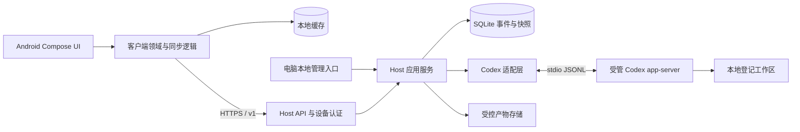

# 首版架构设计

日期：2026-10-23。状态：产品架构设计基线；仅 M0 stdio 探针已有实现，业务模块与性能尚未验证，实际进度见 [progress.md](../progress.md)。产品范围见 [PRD](PRD.md)，字段和状态以 [PROTOCOL.md](PROTOCOL.md) 为准。

## 1. 系统边界

Android 负责视图、缓存、同步、阅读位置和受限操作。Host 负责认证、会话归属、状态、顺序、审批和进程生命周期。Codex 负责 Agent 执行及其权限机制。Runvori 不复刻模型循环，不实现终端模拟器，也不直接向手机暴露 app-server。

## 2. 运行与模块约定

### Host

首版使用单 Host 进程、单 API worker、一个受管 app-server，以及一个 SQLite 数据库。启动时获取本机单实例锁；没有可靠获得锁就拒绝启动。不得用多个 FastAPI worker 绕过内存进程所有权和活动槽约束。

完整模块规划如下；当前仅 `codex` 探针及 CLI 已建立，其余业务模块待 M0 退出后按 M1 建立：

- `host/src/runvori/api/`：HTTPS API、认证、请求校验、错误映射。
- `host/src/runvori/application/`：启动/中断/审批/同步用例与操作幂等。
- `host/src/runvori/domain/`：状态机、活动槽、审批和验证规则，不依赖 FastAPI。
- `host/src/runvori/infrastructure/`：SQLite、文件、TLS/凭据存储和进程管理。
- `host/src/runvori/codex/`：初始化、RPC 路由、schema 校验及上游事件映射。
- `host/tests/`：领域、数据库事务、API、故障注入和适配器夹具测试。

API 层不得自己改表或直接写 app-server stdin。每个外部副作用通过应用服务留下操作记录；适配层只转换协议，不决定用户权限。

### Android

计划在 `android/` 建立单应用，先按包划分 `ui / domain / data`，不提前拆分大量 Gradle 模块。

- Compose 订阅不可变 UI 状态；ViewModel 组合状态并响应动作。
- 领域逻辑负责游标、事件归并、审批显示与阅读模式，不依赖 UI 框架。
- 数据层提供 Host API、Room 缓存和凭据存储适配；网络细节不进入 Composable。
- 屏幕状态保存会话 ID、回合 ID、锚点和“跟随最新”标志；完整历史放数据库，不放 SavedStateHandle。

## 3. 数据模型

以下为逻辑模型，不是已生成的数据库 schema：

- `workspaces`：本地 ID、规范化根目录、别名、执行/审批策略及验证命令清单。
- `sessions`：ID、workspace_id、codex_thread_id、标题、last_seq、创建/更新时间。
- `runs`：ID、session_id、codex_turn_id、状态、时间、原因、verification_status、基线引用。
- `active_slot`：固定一行，指向一个非终态 run；事务内预留、终态后释放。
- `events`：唯一 `(session_id, seq)`、run_id、事件种类、payload、记录时间、来源标识。
- `approvals`：请求 ID、run_id、process_epoch、上游 request_id、摘要、请求版本、决定及处理状态。
- `operations`：唯一 `(device_or_local_actor, request_id)`、规范化请求摘要、状态、结果、关联资源、派发阶段。
- `artifacts`：ID、run_id、类型、内容哈希、大小、受控相对路径、来源、是否截断及可用性。
- `devices`：唯一有效设备、令牌摘要、授权代次、创建/撤销时间。

外键有效，时间统一 UTC，序号是 64 位整数。上游 request_id 可能在新进程重复，必须加 `process_epoch` 隔离。客户端主键包含 `host_id`，避免换 Host 后错误拼接缓存。

大输出采用有界块或产物引用，不能把无限正文塞进单个快照。文件存储先写临时内容、校验后原子更名，最后事务登记；崩溃后的孤立临时文件由本地清理，不能返回不存在的成功产物。

## 4. 写入和读出路径

### 上游事件到手机

1. 适配层验证消息并映射为领域事件；未知可选通知只记录诊断，未知控制请求不得静默忽略。
2. 在 SQLite 单事务内取得下一 `seq`，写事件，更新回合/审批/快照及 `last_seq`。
3. 提交成功后唤醒长轮询读取；手机收到的事件全部已有持久记录。
4. 客户端在一个本地事务内写事件、更新投影并推进连续游标；事务失败不推进游标。

启用 SQLite 外键、WAL 和适当的同步持久化配置（首版采用 `synchronous=FULL`）；SQLite 提交是本地持久边界，不能承诺对硬件故障或不可靠文件系统的绝对保护。

快照在一致性读事务内返回 `snapshot_seq` 和截至该序号的状态。手机从 `after_seq=snapshot_seq` 补增量；历史时间线另按页读取。长轮询建立前后再次检查游标，避免读取与订阅之间丢唤醒。

### 手机控制操作

1. 验证设备、协议版本、资源归属、请求标识、资源版本和当前活动回合。
2. 事务内落操作记录及状态变更；重复标识返回已有操作，不重新执行。
3. 仅领取尚未派发的操作；先标记 `dispatching`，再进行一次上游发送。
4. 上游响应/事件到达后更新结果；无法确认是否送达则标记 `unknown` 并执行有界核对。

数据库和 stdio 没有共同事务。`dispatching` 写入后、发送前崩溃，和发送后、确认前崩溃可能无法区分。首版选择不自动重发含副作用的操作；展示不确定，必要时停止旧执行后由用户重新发起。此处不承诺跨进程“恰好一次执行”。

## 5. 单活动回合

创建回合必须原子检查/预留 `active_slot`，插入 `starting` 回合和操作。RPC 成功再绑定上游 turn。`starting / running / waiting_approval / interrupting` 都占用活动槽。

启动 RPC 超时不能立即释放槽并再次启动。先查询可获得的上游状态；无法消除不确定性时，关闭/隔离受管执行并记录中断。所有手机和本地入口使用同一应用服务。

终态重复事件不重复释放其他回合的槽。终态更新条件必须带预期 `run_id` 和版本，不能执行无条件“清空活动任务”。

## 6. 三类恢复

### 手机重新连接

Host 执行继续。手机读缓存，恢复网络后获取 Host 身份、协议和快照，补齐连续事件、刷新审批及未确认操作；完成同步前禁用写操作。超过保留范围/游标非法则清理该会话投影并以快照重建，历史仍可分页读取。

### 历史会话继续

确认没有活动回合且工作区存在后，由用户明确发起。适配层加载原 thread，再建立新 turn 和新 run。加载失败保留历史记录并提示，不暗中换 thread，也不继续旧 run。

### Host 或 app-server 进程退出

- 每次进程启动产生新的 epoch；记录受管进程身份，不能只依赖可能复用的 PID。
- 异常恢复时先关闭网络写入口、获取锁、核对和终止/隔离遗留子进程，再处理活动槽。
- 对无法继续的非终态 run 追加 `run.interrupted`，原因如 `host_restart` 或 `upstream_exit`；未完成审批失效，可能已发送的操作保留不确定结果。
- 旧进程无法确认停止时，保持 Host 只读并显示 `execution_unavailable`，不能并行启动新执行。
- 不自动重放决定，不自动重启任务。已经提交的事件保留；崩溃前未提交部分不能保证恢复。

具体的进程树管理和退出行为取决于首发 OS，必须在 M0 验证，不能仅在文档中假定成立。

## 7. 执行结果与差异

回合状态、验证状态、产物状态分开保存。命令项必须来自上游结构化执行事实，包括 cwd、命令、退出码、开始/结束时间；缺失值保留 null。模型文本中的“测试通过”不参与验证状态计算。

Host 本地为工作区登记必需验证命令及匹配方式；只有能无歧义关联的结构化执行项才计入。测试命令可以由 Agent 执行，未执行或关联不明确时分别为 `not_run` 或 `unknown`，不为补齐报表擅自执行远程命令。

首轮启动记录工作区 Git 状态及可获得的基线。优先显示上游提供的本回合文件改动；Git 回合前后对比作为补充，不能把已有脏工作区差异归因于 Agent。未跟踪文件、二进制、重命名和大文件的能力在 M0 核查；不支持时明确显示限制。

## 8. 容量与失败处理

- 网络响应、事件块、产物块和内存队列均有界；具体限额见协议。
- 上游读取与持久化失去吞吐平衡时，不能丢审批或终态事件来维持流畅。队列耗尽即安全停止回合并记录原因。
- 首版不自动淘汰事件；已终态会话由 Host 本地显式删除，客户端缓存独立限额。磁盘水位警告并拒绝新任务，保留紧急记录空间。
- 若磁盘已经无法写入，进入只读/故障状态并停止受管进程；恢复后补记中断及可能缺失的尾部范围，不能声称已成功持久化。
- 诊断记录请求标识、事件序号、耗时、队列长度和故障分类；正文及敏感命令默认不进入诊断日志。

## 9. 外部依据与技术验证

核查日期：2026-10-23。OpenAI 官方文档提供 app-server 的 stdio JSONL、初始化、thread/turn 生命周期、审批请求，以及按 CLI 版本导出 schema 的说明。首版使用该集成方向，字段映射以锁定版本的实际 schema 和脱敏夹具为准。[Codex App Server 官方文档](https://learn.chatgpt.com/docs/app-server)

以上模块、数据模型、恢复策略和限制均为 Runvori 的设计选择。版本兼容性、进程管理、审批确认语义和差异采集需要实测，记录在 [DECISIONS.md](DECISIONS.md)。
