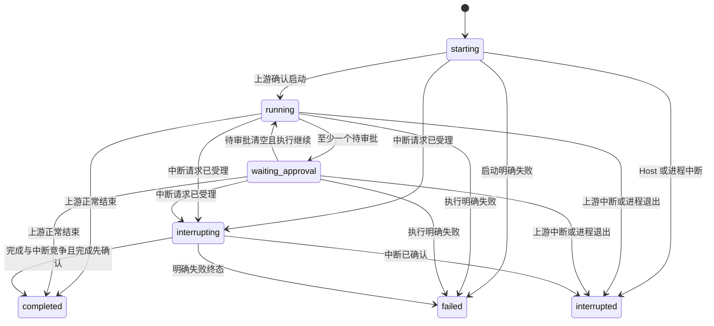

# Host—Android 接口与状态协议

协议：`runvori.v1`。更新日期：2026-10-24。状态：首版拟定契约，无已部署服务。这里定义的是 Runvori 自有 HTTPS API，不是 Codex 的原生接口。

## 1. 公共约定

- JSON 使用 UTF-8、snake_case；时间是 UTC RFC 3339 字符串。
- ID 是不透明字符串，不从路径、时间或上游 ID 推导；`seq` 和版本号是非负 64 位整数。
- 路径前缀 `/v1`；除配对交换外，请求携带 `Authorization: Bearer <device_token>` 和 `X-Runvori-Protocol: 1`。
- `host_id` 标识安装实例，数据库重建/身份丢失必须换 ID；恢复旧备份使序号可能倒退时也换 ID 并重新配对。
- 普通列表使用不透明游标 `cursor`，`limit` 默认 50、最大 100；响应含 `items` 与 `next_cursor`。
- 控制操作携带客户端生成并持久保存的 `request_id`，同一标识不得用于不同请求。身份代次、HTTP 方法、规范化路径和请求体共同参与摘要。
- `version` 与 `session_version` 是对应资源的乐观并发版本，状态、决定、活动回合或可操作性改变时在同一事务递增；单纯输出 delta 不递增控制版本，避免持续输出导致所有审批都冲突。事件 seq 仍逐条递增。
- 控制操作 `202` 只表示 Host 已持久受理，必须跟踪操作或资源状态；客户端不据此宣布审批/中断/执行成功。
- 未定义字段可忽略；未知状态或控制类型必须禁止操作并提示兼容性问题。破坏性变化升级主版本。
- 普通 JSON 请求体最大 64 KiB，后续输入最大 16 KiB；事件单块最大 64 KiB，单页响应最大 256 KiB，产物分块最大 256 KiB。超限返回 `413 payload_too_large`，不能静默丢内容。

## 2. API 清单

### Host 与配对

- `GET /v1/host`：认证后返回 `host_id`、Host 版本、协议、Codex 兼容状态、执行是否可用、活动 run ID、server_time。
- `POST /v1/pairings/exchange`：唯一不要求设备令牌的接口；提交短时 `pairing_secret` 和设备显示名，返回 `device_id`、`device_token`、`host_id`。交换事务原子消费秘密，限流，且最多一个有效设备。

配对秘密、TLS 身份绑定和撤销策略见 [SECURITY.md](../SECURITY.md)。交换响应丢失时不重复发令牌；在 Host 本地撤销可能创建的设备并重新配对。生成配对信息、登记工作区和撤销设备仅由 Host 本地入口提供，不新增远端管理接口。

### 会话与快照

- `GET /v1/sessions?cursor=...&limit=...`：会话摘要分页。
- `GET /v1/sessions/{session_id}/snapshot`：一致性快照。
- `GET /v1/sessions/{session_id}/runs?cursor=...&limit=...`：历史回合分页，最近优先。
- `GET /v1/runs/{run_id}`：单回合状态和验证摘要。

手机无远端创建工作区/首会话接口；首会话由本地入口调用同一应用服务创建。快照示例：

```json
{
  "host_id": "host_demo",
  "session_id": "sess_demo",
  "snapshot_seq": 128,
  "session_version": 16,
  "workspace_name": "demo-repo",
  "active_run": {"run_id": "run_demo", "status": "waiting_approval", "version": 7},
  "open_approval_ids": ["apr_demo"],
  "recent_events": [],
  "history_before_seq": 129,
  "server_time": "2026-10-23T04:00:00Z"
}
```

`active_run` 可以为 null；最近一个已终态回合在会话摘要和回合列表中返回。`open_approval_ids` 包含 pending、decision_recorded、dispatching、unknown 中仍未确认结束的请求，不能据此判断每一项都可批准。`recent_events` 是截至 `snapshot_seq` 的有界尾页，可为空；`history_before_seq` 是继续向前加载历史的排他边界，非完整历史声明。返回的状态及事件均来自同一读事务；详情资源仍须检查自身版本。

### 事件同步与历史

- `GET /v1/sessions/{session_id}/events?after_seq=128&limit=100&wait_ms=25000`：按序获取增量，`after_seq` 排他。
- `GET /v1/sessions/{session_id}/events?before_seq=129&limit=100`：读取历史前一页，`before_seq` 排他，响应仍按 seq 升序。
- 两个边界不能同时传。无边界等价于 `after_seq=0`；`wait_ms` 仅增量接口可用，范围 0–25000，默认 0。

响应包含 `events`、`next_after_seq`（增量使用）、`next_before_seq`（历史使用）、`latest_seq`、`has_more`。无新事件长轮询超时正常返回 `200` 空数组，游标不变；不得返回伪造事件推动游标。事件示例：

```json
{
  "schema_version": 1,
  "session_id": "sess_demo",
  "seq": 129,
  "run_id": "run_demo",
  "type": "approval.requested",
  "recorded_at": "2026-10-23T04:00:01Z",
  "payload": {"approval_id": "apr_demo", "approval_version": 1}
}
```

每会话 seq 从 1 开始，已提交事件连续递增；跨会话不比较 seq。分页受字节数和条数双重限制。非法负数返回 `400 invalid_cursor`，超出当前 last_seq 返回 `409 cursor_ahead`，被删除会话返回 `404 session_not_found`。以后引入历史裁剪时，缺失游标返回 `410 cursor_expired`，手机重取快照，不能把缺口当成追平。

首版使用 HTTPS 长轮询，不增加 WebSocket/SSE 双通道。手机仅在前台同步，失败按 1、2、4、8、最多 30 秒加抖动重试；恢复网络可触发立即查询。写操作不按此规则自动重试。

### 审批

- `GET /v1/runs/{run_id}/approvals?status=pending&cursor=...&limit=...`：查询审批，可省略 status 读取所有状态。
- `GET /v1/approvals/{approval_id}`：审批详情、版本和关联操作。
- `POST /v1/approvals/{approval_id}/decision`：提交 `request_id`、`expected_version`、`decision`（`allow_once` 或 `deny`）。

审批资源包含 `approval_id / run_id / kind / version / status / requested_at / expires_at / operation_id`，以及结构化的命令、cwd、变更路径或差异引用、reason、allowed_decisions。`expires_at` 无可靠上游期限时为 null，不人为以手机时间判定过期；回合终止/请求被清理也会使审批失效。

Host 校验当前 epoch、请求仍待处理、回合未终止且版本匹配。一个审批只接受一个不可变决定；同请求标识返回原操作，不同标识对同一决定返回已有操作，对相反决定返回 `409 decision_conflict`。版本冲突返回 `409 resource_changed` 并要求刷新，已失效返回 `410 approval_expired`。

### 中断与后续输入

- `POST /v1/runs/{run_id}/interrupt`：`request_id`、`expected_version`。
- `POST /v1/sessions/{session_id}/runs`：`request_id`、`expected_session_version`、`input`。仅给已有会话创建新回合，不允许传 cwd、模型凭据或改变执行策略。
- `GET /v1/operations/{request_id}`：当前设备查询自己的受理/派发/确认结果。

中断目标已终态返回 `200` 当前终态，不再次中断；已有中断操作返回原操作。审批已派发时中断仍可请求，不能承诺先前决定尚未生效。新回合遇到全局活动槽返回 `409 active_run_exists`；thread 不可加载返回 `409 thread_unavailable`；执行环境不可用返回 `503 execution_unavailable`。

受理示例：

```json
{
  "request_id": "req_demo",
  "status": "accepted",
  "resource_id": "apr_demo",
  "recorded_at": "2026-10-23T04:00:02Z"
}
```

### 结果和产物

- `GET /v1/runs/{run_id}/results`：回合状态、验证汇总、必需验证项和证据引用；命令明细分页读取。
- `GET /v1/runs/{run_id}/commands?cursor=...&limit=...`：命令、cwd、状态、退出码、时间和输出产物。
- `GET /v1/runs/{run_id}/artifacts?cursor=...&limit=...`：差异/输出清单，包含来源、大小、哈希、截断和可用性。
- `GET /v1/artifacts/{artifact_id}/content?offset=0&limit=262144`：受控内容的字节块，返回 `application/octet-stream`，元数据响应头含总大小、当前偏移、下一偏移和内容哈希。禁止在 API 中传本地文件路径。

文本分块由客户端增量 UTF-8 解码，不能逐块破坏多字节字符；二进制仅显示元信息。偏移非法返回 `416 invalid_range`；被删除/丢失产物返回 `410 artifact_unavailable`，列表仍保留不可用记录，不伪装成空内容。

## 3. 回合状态机

非终态：`starting / running / waiting_approval / interrupting`。终态：`completed / failed / interrupted`。



快速执行时可以从 starting 直接观测终态；适配层须接受此情况，不依赖手机看到所有中间画面。终态不可倒退；相同终态重复消息幂等，相互矛盾的上游终态保留诊断并触发核对。多个待审批可属于同一回合；decision_recorded、dispatching 和 unknown 仍属于未确认结束的请求，只有全部请求明确解除且未在中断时才回到 running。

## 4. 审批与操作状态

审批状态：

- `pending`：上游请求存在，尚未接受决定。
- `decision_recorded`：Host 已持久接收一个决定，尚未领取发送。
- `dispatching`：一次派发已开始，不能保证上游已处理。
- `resolved`：有兼容适配层认可的上游证据表明请求已处理/结束；不代表命令执行成功。
- `expired`：请求因回合结束、明确清理、epoch 变化等失效，不可再批准。
- `unknown`：可能已派发，但确认不足，禁止再次点击允许并查询核对。

`pending → decision_recorded → dispatching → resolved` 是正常流程；尚未确认的状态都可能进入 expired 或 unknown，且必须保留已记录的决定。unknown 只有取得证据后才转 resolved/expired，不回到 pending 自动重发。上游“请求已清理”不能证明本次批准生效，原因必须分别保存。

匹配 epoch、上游请求标识与已绑定回合的“请求已结束”证据使 `pending/decision_recorded` 审批失效，使 `dispatching/unknown` 审批变为 `resolved`。未派发操作记 `failed/request_closed_before_dispatch`；已领取操作可记 `confirmed/request_closed`，其中 `request_closed` 只确认请求结束，不证明允许决定被采用、工具副作用发生或命令成功。重复同一关闭证据不追加事件；不同请求身份不能复用该证据。

操作状态为 `accepted / dispatching / confirmed / failed / unknown`。`confirmed` 对新回合表示已识别上游 turn，对中断表示终态已确认，对审批表示请求处理证据已确认；每个响应包含具体 `outcome`，不能把通用 confirmed 渲染为“测试通过”。

`request_id` 的幂等记录随会话保留。重复 key 同请求返回已有状态；同 key 不同请求返回 `409 idempotency_conflict`。已受理操作跨 HTTP 响应丢失仍可查询；数据库清空/设备重新配对后，旧 key 不属于新身份，客户端不得跨身份自动重发。

若操作查询返回 `404 operation_not_found`，只有确认 host_id、配对代次和资源版本仍一致后，用户才可显式使用原 request_id 重试原请求；不能换 key 自动补发。Host 必须坚持“先持久受理、后派发”，以使未登记请求不会已经执行。

派发过程中 Host 与上游之间不存在原子提交。重启后未领取的旧操作也不自动发送；旧回合被中断，操作按证据标 failed/unknown。首版保证不因 HTTP 重试重复派发，不承诺上游副作用在崩溃下恰好执行一次。

审批派发的持久边界如下：决定与客户端 `request_id` 在同一事务记录；发送上游答复前，先将该审批从 `decision_recorded` 原子领取为 `dispatching` 并提交。领取成功只授予当前进程一次发送机会；领取后的任何写入异常或 Host 退出均视为可能已发送。启动新进程 epoch 前须确认旧受管进程已停止或隔离；旧 epoch 的 `pending/decision_recorded` 失效，`dispatching` 转为 `unknown`，均不自动发送。只读核对可记录文件现状，但不能仅凭文件存在或缺失把 unknown 改写为批准成功、失败或可重试；上游请求结束证据也须与副作用证据分开记录。

## 5. 事件种类与投影

首版规范化事件包括：

- `run.created / run.started / run.completed / run.failed / run.interrupted`。
- `message.started / message.delta / message.completed`，payload 带稳定 `item_id`，delta 带块序号。
- `command.started / command.output / command.completed`，payload 带 `item_id` 与输出块或产物引用。
- `file_change.updated / artifact.created / artifact.unavailable`。
- `approval.requested / approval.updated / operation.updated`。
- `verification.updated / diagnostic.recorded`。

所有增量事件均按 `(session_id, seq)` 去重。item 更新按同一事件流归并；客户端在应用事件并提交缓存事务后才推进连续游标。未知事件也记录已收到的 seq，并显示“此内容需升级客户端”，不能悄悄省略审批/终态后继续开放操作。发现未知控制语义时进入 incompatible 只读态。

连接状态由客户端推导，不伪装成服务端执行事实。快照重新加载不能丢失阅读锚点；锚点引用的 item/seq 尚未加载时，先定位对应历史页，再恢复偏移。

## 6. 验证汇总

验证项状态：`pending / running / passed / failed / unknown / not_run`；汇总使用同一枚举。

- 必需验证项为空时为 `not_run`，不使用空集“全部通过”。
- 任一必需项有已确认非零退出码则汇总 failed。
- 有必需项仍执行则 running；有待执行且回合未结束则 pending。
- 回合结束后缺失证据/中断执行项为 unknown，明确未运行项为 not_run。
- 全部必需项都有完整结构化记录、匹配到本回合、退出码为 0 才 passed。
- 多项混合时优先级 `failed > running > unknown > not_run > pending > passed`；上面的“回合结束”规则先归一化单项，再计算汇总。

回合 completed 与验证 failed 可以同时成立，UI 必须显示两者。退出码 null 不能转为 0。命令列表包括非验证命令，不要求所有命令零退出才算必需验证通过。

## 7. 错误模型与重连

错误统一结构：`{"error":{"code":"resource_changed","message":"状态已变化，请刷新","request_id":"req_demo","retryable":false}}`。不返回原始栈、令牌、上游完整消息或绝对私有路径。

- `400` 参数/游标错误；`401` 凭据失效；`403` 不允许的动作/范围；`404` 资源不存在或不归当前受管集合。
- `409` 版本/活动槽/幂等冲突；`410` 审批或资源失效；`413` 超限；`416` 无效内容区间。
- `429` 限流，带 `Retry-After`；`503` 执行不可用；`507` 存储不足。
- 协议不兼容返回 `409 protocol_incompatible`，带受支持的协议主版本列表。
- `retryable=true` 只说明可以在条件改善后核对/重试，不授权对副作用生成新 request_id。

重连顺序：认证/Host 身份 → 检查协议 → 快照与游标核对 → 补齐事件 → 刷新待审批及未确认操作 → 开放写操作。若 host_id 改变或游标倒退，停止合并缓存，提示重新配对/重建，不能静默接续旧执行。
