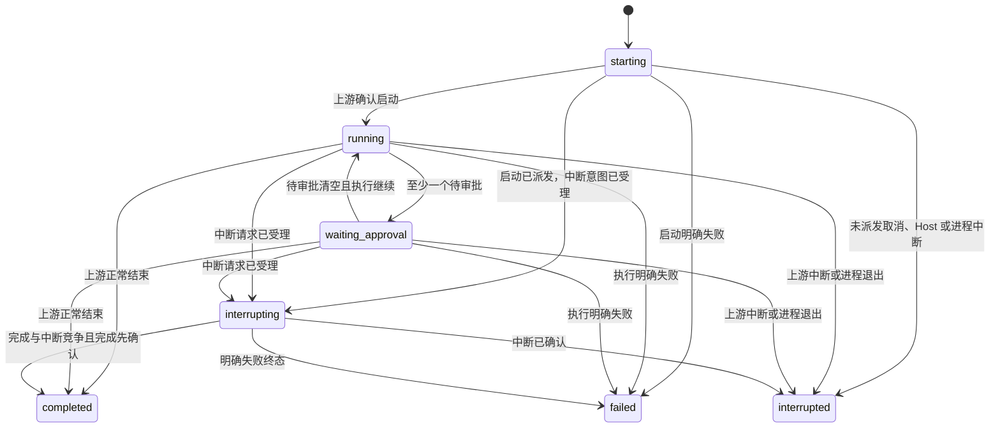

# Host—Android 接口与状态协议

协议：`runvori.v1`。更新日期：2026-10-24。状态：首版拟定契约，无已部署服务。这里定义的是 Runvori 自有 HTTPS API，不是 Codex 的原生接口。

## 1. 公共约定

- JSON 使用 UTF-8、snake_case；时间是 UTC RFC 3339 字符串。
- ID 是不透明字符串，不从路径、时间或上游 ID 推导；`seq` 和版本号是非负 64 位整数。
- 路径前缀 `/v1`；除配对交换外，请求携带 `Authorization: Bearer <device_token>` 和 `X-Runvori-Protocol: 1`。
- `host_id` 标识安装实例，数据库重建/身份丢失必须换 ID；恢复旧备份使序号可能倒退时也换 ID 并重新配对。
- 普通列表使用不透明游标 `cursor`，`limit` 默认 50、最大 100；响应含 `items` 与 `next_cursor`。
- 控制操作携带客户端生成并持久保存的 `request_id`，同一标识不得用于不同请求。身份代次、HTTP 方法、规范化路径和请求体共同参与摘要。
- `version` 与 `session_version` 是对应资源的乐观并发版本，状态、决定、活动回合或可操作性改变时在同一事务递增；单纯输出 delta 不递增控制版本，避免持续输出导致所有审批都冲突。事件 seq 仍逐条递增。
- 控制操作 `202` 只表示 Host 已持久受理，必须跟踪操作或资源状态；客户端不据此宣布审批/中断/执行成功。
- 未定义字段可忽略；未知状态或控制类型必须禁止操作并提示兼容性问题。破坏性变化升级主版本。
- 普通 JSON 请求体最大 64 KiB，后续输入最大 16 KiB；事件单块最大 64 KiB，单页响应最大 256 KiB，产物分块最大 256 KiB。超限返回 `413 payload_too_large`，不能静默丢内容。

## 2. API 清单

### Host 与配对

- `GET /v1/host`：认证后返回 `host_id`、Host 版本、协议、Codex 兼容状态、执行是否可用、活动 run ID、server_time。
- `POST /v1/pairings/exchange`：唯一不要求设备令牌的接口；提交短时 `pairing_secret` 和设备显示名，返回 `device_id`、`device_token`、`host_id`。交换事务原子消费秘密，限流，且最多一个有效设备。

配对秘密、TLS 身份绑定和撤销策略见 [SECURITY.md](../SECURITY.md)。交换响应丢失时不重复发令牌；在 Host 本地撤销可能创建的设备并重新配对。生成配对信息、登记工作区和撤销设备仅由 Host 本地入口提供，不新增远端管理接口。现有 `revoke-device` CLI 只在 Host 单实例锁空闲时离线撤销独立配对库；它不是运行中管理通道，锁冲突不得直接修改数据库。

### 会话与快照

- `GET /v1/sessions?cursor=...&limit=...`：会话摘要分页。
- `GET /v1/sessions/{session_id}/snapshot`：一致性快照。
- `GET /v1/sessions/{session_id}/runs?cursor=...&limit=...`：历史回合分页，最近优先。
- `GET /v1/runs/{run_id}`：单回合状态和验证摘要。

手机无远端创建工作区/首会话接口；首会话由本地入口调用同一应用服务创建。快照示例：

```json
{
  "host_id": "host_demo",
  "session_id": "sess_demo",
  "snapshot_seq": 128,
  "session_version": 16,
  "workspace_name": "demo-repo",
  "active_run": {"run_id": "run_demo", "status": "waiting_approval", "version": 7},
  "open_approval_ids": ["apr_demo"],
  "recent_events": [],
  "history_before_seq": 129,
  "server_time": "2026-10-23T04:00:00Z"
}
```

`active_run` 可以为 null；最近一个已终态回合在会话摘要和回合列表中返回。`open_approval_ids` 包含 pending、decision_recorded、dispatching、unknown 中仍未确认结束的请求，不能据此判断每一项都可批准。`recent_events` 是截至 `snapshot_seq` 的有界尾页，可为空；`history_before_seq` 是继续向前加载历史的排他边界，非完整历史声明。返回的状态及事件均来自同一读事务；详情资源仍须检查自身版本。

### 事件同步与历史

- `GET /v1/sessions/{session_id}/events?after_seq=128&limit=100&wait_ms=25000`：按序获取增量，`after_seq` 排他。
- `GET /v1/sessions/{session_id}/events?before_seq=129&limit=100`：读取历史前一页，`before_seq` 排他，响应仍按 seq 升序。
- 两个边界不能同时传。无边界等价于 `after_seq=0`；`wait_ms` 仅增量接口可用，范围 0–25000，默认 0。

响应包含 `events`、`next_after_seq`（增量使用）、`next_before_seq`（历史使用）、`latest_seq`、`has_more`。无新事件长轮询超时正常返回 `200` 空数组，游标不变；不得返回伪造事件推动游标。事件示例：

```json
{
  "schema_version": 1,
  "session_id": "sess_demo",
  "seq": 129,
  "run_id": "run_demo",
  "type": "approval.requested",
  "recorded_at": "2026-10-23T04:00:01Z",
  "payload": {"approval_id": "apr_demo", "approval_version": 1}
}
```

每会话 seq 从 1 开始，已提交事件连续递增；跨会话不比较 seq。分页受字节数和条数双重限制。非法负数返回 `400 invalid_cursor`，超出当前 last_seq 返回 `409 cursor_ahead`，被删除会话返回 `404 session_not_found`。以后引入历史裁剪时，缺失游标返回 `410 cursor_expired`，手机重取快照，不能把缺口当成追平。

首版使用 HTTPS 长轮询，不增加 WebSocket/SSE 双通道。手机仅在前台同步，失败按 1、2、4、8、最多 30 秒加抖动重试；恢复网络可触发立即查询。写操作不按此规则自动重试。

### 审批

- `GET /v1/runs/{run_id}/approvals?status=pending&cursor=...&limit=...`：查询审批，可省略 status 读取所有状态。
- `GET /v1/approvals/{approval_id}`：审批详情、版本和关联操作。
- `POST /v1/approvals/{approval_id}/decision`：提交 `request_id`、`expected_version`、`decision`（`allow_once` 或 `deny`）。

审批资源包含 `approval_id / run_id / kind / version / status / requested_at / expires_at / operation_id`，以及结构化的命令、cwd、变更路径或差异引用、reason、allowed_decisions。`expires_at` 无可靠上游期限时为 null，不人为以手机时间判定过期；回合终止/请求被清理也会使审批失效。

Host 校验当前 epoch、请求仍待处理、回合未终止且版本匹配。一个审批只接受一个不可变决定；同请求标识返回原操作，不同标识对同一决定返回已有操作，对相反决定返回 `409 decision_conflict`。版本冲突返回 `409 resource_changed` 并要求刷新，已失效返回 `410 approval_expired`。

### 中断与后续输入

- `POST /v1/runs/{run_id}/interrupt`：`request_id`、`expected_version`。
- `POST /v1/sessions/{session_id}/runs`：`request_id`、`expected_session_version`、`input`。仅给已有会话创建新回合，不允许传 cwd、模型凭据或改变执行策略。
- `GET /v1/operations/{request_id}`：当前设备查询自己的受理/派发/确认结果。

中断目标已终态返回 `200` 当前终态，不再次中断；已有中断操作返回原操作。审批已派发时中断仍可请求，不能承诺先前决定尚未生效。新回合遇到全局活动槽返回 `409 active_run_exists`；thread 不可加载返回 `409 thread_unavailable`；执行环境不可用返回 `503 execution_unavailable`。

当前 M0 持久切片受理已绑定上游 turn 的 `running / waiting_approval` 回合中断。事件库 v10 在一个事务中记录不可变请求摘要、`accepted` 操作、`interrupting` 回合状态、事件和快照；重复同一请求返回原操作，同回合另一个请求返回已有操作，已终态回合返回终态而不创建操作。`starting` 且启动操作仍为 `accepted`、尚未领取发送权且无上游 turn 绑定时，可在同一事务直接取消：启动操作记 `failed/cancelled_before_dispatch`，中断操作记 `confirmed/run_interrupted`，写入终态事件并释放活动槽；原中断请求重放返回同一操作。启动发送权已领取而 turn 未绑定时，中断意图先持久化为 `accepted`，回合进入 `interrupting`；收到有效 `turn/start` 响应后才绑定 turn，保留 `interrupting` 状态，由当前连接所有者按绑定一次派发中断。启动响应丢失时不猜测 turn 身份；隔离恢复将未派发中断记为 `failed/not_dispatched`，已领取但未确认的启动保持 `unknown`。

`claim_interrupt_dispatch` 只对匹配上游 turn epoch、活动槽和 `accepted` 操作授予一次发送权；领取后失败可记 `unknown`，必须带原派发 epoch。当前连接所有者从持久操作读取 run，再核对活动槽、session/thread 绑定及 turn epoch，领取后一次调用 `turn/interrupt`。RPC 正常响应只保留 `dispatching`，直到独立终态；匹配的 RPC 错误保留 `unknown` 并继续读取同一连接，避免丢失可能已缓冲的完成事件。传输失效则关闭并隔离连接，不自动重发。回合终态同事务结算操作：未派发记 `failed/terminal_before_dispatch`；已领取或未知操作记 `confirmed/run_completed|run_failed|run_interrupted`，此 outcome 只表示最终回合状态，不归因中断的效果。进程隔离恢复时未派发记 `failed/not_dispatched`，已领取记 `unknown/dispatch_unconfirmed`，原本未知保持未知。任何一步事件写入失败须回滚整次结算。

中断队列只携带已持久操作的操作者与请求标识；当前连接所有者在事件轮询前消费一个信号。重复、已终态或绑定不符的信号不能再次发送。队列满或进程重启不授权自动重发；尚未派发的操作需要调用方查询与显式处理，产品 API 仍待接入。

受理示例：

```json
{
  "request_id": "req_demo",
  "status": "accepted",
  "resource_id": "apr_demo",
  "recorded_at": "2026-10-23T04:00:02Z"
}
```

### 结果和产物

- `GET /v1/runs/{run_id}/results`：回合状态、验证汇总、必需验证项和证据引用；命令明细分页读取。
- `GET /v1/runs/{run_id}/commands?cursor=...&limit=...`：命令、cwd、状态、退出码、时间和输出产物。
- `GET /v1/runs/{run_id}/artifacts?cursor=...&limit=...`：差异/输出清单，包含来源、大小、哈希、截断和可用性。
- `GET /v1/artifacts/{artifact_id}/content?offset=0&limit=262144`：受控内容的字节块，返回 `application/octet-stream`，元数据响应头含总大小、当前偏移、下一偏移和内容哈希。禁止在 API 中传本地文件路径。

文本分块由客户端增量 UTF-8 解码，不能逐块破坏多字节字符；二进制仅显示元信息。偏移非法返回 `416 invalid_range`；被删除/丢失产物返回 `410 artifact_unavailable`，列表仍保留不可用记录，不伪装成空内容。

## 3. 回合状态机

非终态：`starting / running / waiting_approval / interrupting`。终态：`completed / failed / interrupted`。



快速执行时可以从 starting 直接观测终态；适配层须接受此情况，不依赖手机看到所有中间画面。终态不可倒退；相同终态重复消息幂等，相互矛盾的上游终态保留诊断并触发核对。多个待审批可属于同一回合；decision_recorded、dispatching 和 unknown 仍属于未确认结束的请求，只有全部请求明确解除且未在中断时才回到 running。

## 4. 审批与操作状态

审批状态：

- `pending`：上游请求存在，尚未接受决定。
- `decision_recorded`：Host 已持久接收一个决定，尚未领取发送。
- `dispatching`：一次派发已开始，不能保证上游已处理。
- `resolved`：有兼容适配层认可的上游证据表明请求已处理/结束；不代表命令执行成功。
- `expired`：请求因回合结束、明确清理、epoch 变化等失效，不可再批准。
- `unknown`：可能已派发，但确认不足，禁止再次点击允许并查询核对。

`pending → decision_recorded → dispatching → resolved` 是正常流程；尚未确认的状态都可能进入 expired 或 unknown，且必须保留已记录的决定。unknown 只有取得证据后才转 resolved/expired，不回到 pending 自动重发。上游“请求已清理”不能证明本次批准生效，原因必须分别保存。

匹配 epoch、上游请求标识与已绑定回合的“请求已结束”证据使 `pending/decision_recorded` 审批失效，使 `dispatching/unknown` 审批变为 `resolved`。未派发操作记 `failed/request_closed_before_dispatch`；已领取操作可记 `confirmed/request_closed`，其中 `request_closed` 只确认请求结束，不证明允许决定被采用、工具副作用发生或命令成功。重复同一关闭证据不追加事件；不同请求身份不能复用该证据。

上游 `requestId` 的整数和字符串形态按类型编码，结束通知还须以 `threadId`、当前 epoch 和已绑定回合定位审批；不能只按请求号或调用方给出的审批 ID 处理通知。未知或不匹配的通知不改变状态。

同一上游审批请求身份重复到达时，Host 对方法和完整参数的规范化摘要做比较；内容一致返回原审批，内容变化视为上游身份冲突并保持原记录。摘要不代替命令、cwd 或文件变更内容的安全审查。

上游 `turn/completed` 通知须同时匹配当前进程代次、已绑定的 `threadId` 与 `turn.id`，再按 `turn.status` 的 `completed / failed / interrupted` 写回合终态并释放活动槽。同一事务使待决定与已记录但未派发的审批失效，未派发操作记失败；已领取但未确认的审批及操作记未知，原本未知的保持未知。重复相同终态返回原事件；不同终态冲突。回合终态不证明上游请求已清理，也不证明工具副作用或验证命令成功；请求结束仍需独立证据。晚到的结束通知可为已因终态失效的审批补记请求结束证据，不重新启用审批或改变未派发操作结果。

Host 消费一条上游消息时，应在继续读取或答复审批前完成其持久化：已识别的审批请求、请求结束和回合终态分别进入对应事务；未知可选通知仅返回有界诊断标记；未知控制请求及已识别消息的持久化失败须停止该上游连接。该入口不自动答复审批，也不把一次消息处理当作完整产品事件循环。

操作状态为 `accepted / dispatching / confirmed / failed / unknown`。`confirmed` 对新回合表示已识别上游 turn，对中断表示终态已确认，对审批表示请求处理证据已确认；每个响应包含具体 `outcome`，不能把通用 confirmed 渲染为“测试通过”。

`request_id` 的幂等记录随会话保留。重复 key 同请求返回已有状态；同 key 不同请求返回 `409 idempotency_conflict`。已受理操作跨 HTTP 响应丢失仍可查询；数据库清空/设备重新配对后，旧 key 不属于新身份，客户端不得跨身份自动重发。

若操作查询返回 `404 operation_not_found`，只有确认 host_id、配对代次和资源版本仍一致后，用户才可显式使用原 request_id 重试原请求；不能换 key 自动补发。Host 必须坚持“先持久受理、后派发”，以使未登记请求不会已经执行。

派发过程中 Host 与上游之间不存在原子提交。重启后未领取的旧操作也不自动发送；旧回合被中断，操作按证据标 failed/unknown。首版保证不因 HTTP 重试重复派发，不承诺上游副作用在崩溃下恰好执行一次。

审批派发的持久边界如下：决定与客户端 `request_id` 在同一事务记录；发送上游答复前，先将该审批从 `decision_recorded` 原子领取为 `dispatching` 并提交。领取成功只授予当前进程一次发送机会；领取后的任何写入异常或 Host 退出均视为可能已发送。启动新进程 epoch 前须确认旧受管进程已停止或隔离；旧 epoch 的 `pending/decision_recorded` 失效，`dispatching` 转为 `unknown`，均不自动发送。只读核对可记录文件现状，但不能仅凭文件存在或缺失把 unknown 改写为批准成功、失败或可重试；上游请求结束证据也须与副作用证据分开记录。

派发适配层只从已持久化的审批读取上游请求身份和决定，必须核对类型化请求号与已记录请求摘要后领取；不接受调用方传入另一份命令、请求号或决定。stdio 答复写入成功只保留 `dispatching`，等待独立结束证据；写入抛错或连接不可用时关闭上游连接并把已领取操作记 `unknown`，不得重发。

新回合派发时，调用方提供原请求的 session、run、版本和输入；Host 对已持久化的幂等摘要重放核对，确认完全一致后才领取一次 `turn/start` 发送权。每个 session 须先持久绑定一个不可改写的上游 thread ID，同一 thread 不能属于两个 session；派发只从该绑定读取 thread ID，不接受调用方临时指定。响应中必须有非空 turn ID，再按持久 thread ID 与当前 epoch 绑定；审批请求若先于 RPC 响应到达，须在绑定提交后按原顺序持久化。发送、响应形状或绑定失败后关闭上游连接，并把已领取操作记未知，不自动再次启动回合。旧数据库升级不猜测缺失的 session/thread 归属，须由受信任本地流程核对后补记。

重启后恢复历史 thread 须在统一 Host 恢复完成、当前 epoch 已推进后，从持久 session/thread 绑定读取身份，调用 `thread/resume` 并核对响应中的 `thread.id` 完全一致。新回合一次派发也须在当前连接完成这项核对后才领取 `turn/start` 发送权。拒绝、超时或身份不符时关闭该上游连接，保留绑定且不自动创建替代 thread；成功只证明本次连接识别该 thread，不证明旧回合可续跑。

首次创建上游 thread 也须先持久记录会话、调用方请求号与固定参数摘要，再领取一次 `thread/start` 发送权；确认响应中的 thread ID 后，将操作确认与 session/thread 绑定同事务提交。领取后无响应或绑定失败时关闭连接并记未知，禁止对同一会话自动再次创建。重启且旧进程隔离后，未确认的已领取创建保持未知；尚未领取的意图仍可由受信任本地入口显式继续。`cwd` 只允许来自本地工作区登记流程，本切片不开放手机传入任意路径。

本地工作区登记记录不可改写的 ID、规范化根目录和 `read-only|workspace-write` 策略；本地新建会话与其工作区归属须同事务提交。`thread/start` 适配器只读取已登记的会话工作区与策略，发送前再次检查目录仍存在且未穿过符号链接或 junction。旧库升级不猜测已有会话的工作区归属；未登记的旧会话不能创建上游 thread，原有已绑定 thread 的恢复不受影响。工作区登记、修改和会话创建均不开放手机远端入口。

Host 恢复入口在持有单实例锁且确认旧进程已隔离后，将旧审批状态、操作结果、epoch 推进与匹配活动回合的中断/活动槽释放作为一个数据库事务提交。任一写入失败则全部回滚，保持写入口关闭；不能因审批先恢复而提前接受新回合。

当前 Host 的 Windows app-server 连接须在持锁且已恢复的 epoch 下先预留唯一连接位，再启动并初始化；初始化失败且进程确认隔离后释放连接位。重复启动和伪造的连接归属拒绝。当前归属连接退出时，先关闭共享写门控，再关闭 stdio 连接和 kill-on-close Job；只有连接关闭、受管父进程退出且 Job 句柄释放后，才读取活动回合 ID/版本并提交 `upstream_exit` 恢复。关闭失败时不推进 epoch，保持写门控关闭；Host 关闭时也须先隔离其归属连接再释放数据库锁。此入口只证明当前进程内的连接归属；崩溃后遗留进程的隔离证明仍需独立启动编排。

归属连接上的事件交接须逐条读取并先核对连接归属与 epoch。已识别的审批请求、请求结束和回合终态通过既有事务写入；读取或持久化失败时，先隔离连接并执行 `upstream_exit` 恢复，不能继续消费可能失序的消息。恢复事务失败则保持写门控关闭和原 epoch。单步交接的空等待不改变状态；产品长期事件循环与审批答复调度仍待实现。

持续消费入口须在持有 SQLite 连接的 Host 线程中运行，以有界超时轮询单步交接；外部停止信号只在消息间生效。空等待继续轮询，不产生事件；故障恢复后立即结束旧连接循环，不按新 epoch 自动重启。审批答复、本地 `thread/start` 和已受理回合的 `thread/resume`/`turn/start` 已在该线程的有界队列中串行派发；其他 stdio RPC 仍须由后续单所有者调度整合，不能在另一线程并发读取同一连接。

当前有不对外开放的 Host 命令邮箱切片：外部线程只提交固定类型的回合启动、中断和操作查询命令；持有 SQLite 连接的连接所有者每轮最多处理一条。回合 ID 由 Host 生成，先持久受理操作，再向原有有界队列提交派发信号。邮箱等待超时为 `command_result_unknown`，不能推断未提交；调用方必须用原请求号查询。派发信号队列满时返回 `dispatch_signal_unavailable`，已提交的操作仍可查询，调用方可用同一请求号显式重试以重新唤醒。邮箱不提供 HTTP、认证或 TLS，不把入队当作上游确认。

该内部邮箱现可读取单会话的原始存储快照，以及按 `after_seq` 或 `before_seq` 获取事件页；每次读取由 SQLite 所有者执行，沿用事件库的读事务、游标校验、100 条/256 KiB 页上限与 `session_not_found` 错误。先取快照的 `snapshot_seq`，再用该序号作为 `after_seq` 补读后续事件。原始快照仍是内部存储形状，设备鉴权尚未实现。

新增内部 `snapshot_tail` 读取把存储快照、`snapshot_seq`、最近事件及 `history_before_seq` 放在同一 SQLite 读事务中。最近事件以 seq 升序返回，从最新事件向前选取，受 100 条和完整响应 256 KiB 上限约束；`history_before_seq` 为已选最早 seq，空尾页为 `snapshot_seq + 1`。历史页用该值作排他 `before_seq`，增量页仍从 `snapshot_seq` 之后读取。该切片尚缺 `host_id`、服务时间和设备鉴权，不等同于上面的正式 HTTPS 响应。

事件库 v11 现将随机 `host_id` 持久化在权威 Host 数据库中；新库生成一次，旧库升级时与 schema 版本原子提交，已升级库身份缺失或损坏时拒绝打开。连接所有者可通过内部邮箱读取身份，尚未组合成正式快照或 `/v1/host` 响应。独立配对库的一次性秘密与设备令牌要求绑定同一 Host 身份；旧无归属凭据在升级时失效。内部 `HostDeviceAccess` 仅在持锁恢复成功后取得权威身份，再打开配对库并构造读取网关；恢复前不得签发或迁移配对凭据。Host 关闭后旧组合对象拒绝设备操作。产品启动编排仍未接入；旧备份回滚必须由后续受信任恢复流程更换身份并撤销凭据。

内部邮箱现提供增量事件等待入口，`wait_ms` 限定 0–25000，0 为一次读取；等待只发生在请求线程，SQLite 所有者仍处理其他命令和上游消息。持久写入及归属连接事件交接完成后可通知等待线程立即复查；通知只表示可能变化，响应仍以数据库页为准。通知与查询之间用代次核对避免丢唤醒，最多 250 毫秒的定时复查覆盖尚未接入通知的写路径。结果沿用事件库的 `events / next_after_seq / latest_seq / has_more`；超时返回空页和未推进的游标，不插入心跳事件。游标错误及所有者处理超时须返回错误，不能伪装为空页。可信调用方可向内部等待传入取消信号；信号触发后唤醒等待者，排队中或读取后的请求返回 `request_cancelled`，不返回事件页。归属事件循环停止、上游恢复或异常退出时关闭邮箱并唤醒等待者；测试用有界交接返回仍可继续运行。关闭后读取返回 `host_stopped`，已提交情况不明的写请求返回 `command_result_unknown`，新请求拒绝。取消与读完成的并发边界仍要求未来 HTTP 入口在发送响应前重新核验设备权限。该切片尚未接入 HTTP，配对撤销也尚未连接到取消信号。

内部 `DeviceReadGateway` 现用唯一有效设备令牌和可信启动路径提供的当前 `host_id` 保护快照与事件读取：先鉴权、交给邮箱、读取后复核授权；长轮询每次最多等待 250 毫秒后复核，设备已撤销则拒绝该次结果。历史页不允许等待，取消信号传入邮箱。可信 Host 本地调用 `revoke_local_device` 提交撤销后主动取消该网关实例中的在途读取；直接修改配对库只由分段复核发现。此入口尚未映射 HTTP/TLS，返回的是内部存储模型；正式 HTTP 响应发送前仍须重新鉴权，不能把内部复核当作无竞态的交付保证。

审批决定已落库后，可将调用方和请求标识放入有界内存队列，作为唤醒当前连接所有者的信号；队列不承载决定或上游请求内容，也不是持久化事实。所有者从数据库重取、核对并领取一次派发权后才答复 stdio。重复或已失效的队列项不重发；队列满或 Host 崩溃不能抹去已记录决定，也不授权新 epoch 自动补发。派发结果未知或写入失败时隔离当前连接并执行恢复，旧循环立即退出。其他 stdio RPC 的同线程调度和产品 API 仍待实现。

受信任本地 `thread/start` 信号也使用有界队列，队列项仅含已登记会话 ID、本地操作者 ID 和请求 ID；入队不是持久受理。当前连接所有者消费时先从本地工作区登记读取并核对参数，再由原有一次创建适配器记录意图、领取发送权和核对绑定。重复已确认信号只返回绑定，未知创建不重发；响应丢失则隔离连接、恢复 epoch 并结束旧循环。队列满或进程退出前未消费的信号没有持久操作记录，调用方必须查询状态，不能宣称已开始创建。

已持久受理的新回合可用另一有界内存队列唤醒当前连接所有者。队列项携带原 session、run、操作者、请求号、预期版本及至多 16 KiB 的原输入，不承载上游 thread ID；输入只在内存中暂存且不进入诊断。消费时先核对持久操作和输入摘要，再按持久绑定执行 `thread/resume` 身份核对，成功后领取一次 `turn/start` 发送权。输入冲突、重复或未绑定时不发送；恢复身份失败、领取事务故障及已领取后的响应不确定均隔离当前连接并执行恢复，不消费旧队列剩余信号。入队不等于新回合已开始；已受理请求跨重启不自动排队重发。

共享 Host 存储打开后到统一恢复事务成功前，领域写入口拒绝新会话、回合、审批与操作写入；恢复失败后继续拒绝。旧独立探针的审批写方法不能作用于共享库，以免绕过规范化事件和快照。

## 5. 事件种类与投影

首版规范化事件包括：

- `run.created / run.started / run.completed / run.failed / run.interrupted`。
- `message.started / message.delta / message.completed`，payload 带稳定 `item_id`，delta 带块序号。
- `command.started / command.output / command.completed`，payload 带 `item_id` 与输出块或产物引用。
- `file_change.updated / artifact.created / artifact.unavailable`。
- `approval.requested / approval.updated / operation.updated`。
- `verification.updated / diagnostic.recorded`。

所有增量事件均按 `(session_id, seq)` 去重。item 更新按同一事件流归并；客户端在应用事件并提交缓存事务后才推进连续游标。未知事件也记录已收到的 seq，并显示“此内容需升级客户端”，不能悄悄省略审批/终态后继续开放操作。发现未知控制语义时进入 incompatible 只读态。

连接状态由客户端推导，不伪装成服务端执行事实。快照重新加载不能丢失阅读锚点；锚点引用的 item/seq 尚未加载时，先定位对应历史页，再恢复偏移。

## 6. 验证汇总

验证项状态：`pending / running / passed / failed / unknown / not_run`；汇总使用同一枚举。

- 必需验证项为空时为 `not_run`，不使用空集“全部通过”。
- 任一必需项有已确认非零退出码则汇总 failed。
- 有必需项仍执行则 running；有待执行且回合未结束则 pending。
- 回合结束后缺失证据/中断执行项为 unknown，明确未运行项为 not_run。
- 全部必需项都有完整结构化记录、匹配到本回合、退出码为 0 才 passed。
- 多项混合时优先级 `failed > running > unknown > not_run > pending > passed`；上面的“回合结束”规则先归一化单项，再计算汇总。

回合 completed 与验证 failed 可以同时成立，UI 必须显示两者。退出码 null 不能转为 0。命令列表包括非验证命令，不要求所有命令零退出才算必需验证通过。

## 7. 错误模型与重连

错误统一结构：`{"error":{"code":"resource_changed","message":"状态已变化，请刷新","request_id":"req_demo","retryable":false}}`。不返回原始栈、令牌、上游完整消息或绝对私有路径。

- `400` 参数/游标错误；`401` 凭据失效；`403` 不允许的动作/范围；`404` 资源不存在或不归当前受管集合。
- `409` 版本/活动槽/幂等冲突；`410` 审批或资源失效；`413` 超限；`416` 无效内容区间。
- `429` 限流，带 `Retry-After`；`503` 执行不可用；`507` 存储不足。
- 协议不兼容返回 `409 protocol_incompatible`，带受支持的协议主版本列表。
- `retryable=true` 只说明可以在条件改善后核对/重试，不授权对副作用生成新 request_id。

重连顺序：认证/Host 身份 → 检查协议 → 快照与游标核对 → 补齐事件 → 刷新待审批及未确认操作 → 开放写操作。若 host_id 改变或游标倒退，停止合并缓存，提示重新配对/重建，不能静默接续旧执行。
